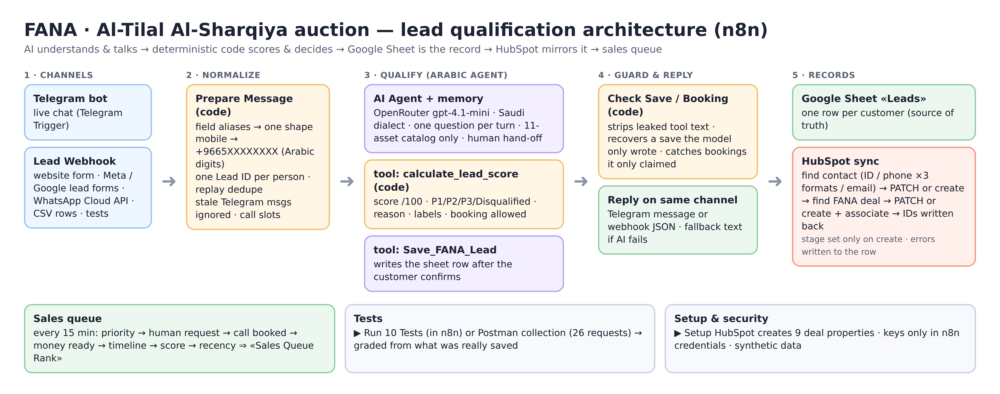

# FANA · Al-Tilal Al-Sharqiya Auction — Lead Qualification (n8n)

One n8n workflow that takes leads from several channels, normalizes them, qualifies them in **Saudi Arabic** with an AI agent, scores them with **transparent deterministic rules**, keeps one record per customer in Google Sheets, syncs **HubSpot Contacts and Deals without duplicates**, and produces a **ranked sales queue**.

> **Core idea:** the AI *understands and talks*; plain code *scores, decides and saves*; a guard checks the AI did what it claimed.

---

## Package contents

| Path | What |
|---|---|
| `docs/Channel_Plan_AR.md` | Acquisition channel plan (Arabic): budget split, audiences, funnel role, KPIs, timeline. |
| `docs/architecture.png` | One architecture diagram of the full flow. |
| `workflow/FANA_Tilal_Final_Workflow.json` | **The runnable prototype.** Import into n8n. Contains no secrets (credential references only). |
| `workflow/code/*.js`, `agent_system_prompt.txt` | Readable copies of every Code node, tool and the agent prompt (identical to the workflow). |
| `tests/FANA_Lead_Webhook.postman_collection.json` | 26 test requests: every source shape, a full conversation, duplicates, and the 10 case-study scenarios. |
| `samples/FANA_Leads_Sheet_Template.xlsx` | The Google Sheet structure (Leads, Scoring Rules, Test Scenarios, Dashboard, Assets). |
| `samples/FANA_Sales_Queue_and_Test_Results.xlsx` | Prioritized sales list + results for the 10 scenarios. |
| `screenshots/` | HubSpot and sheet evidence. |

---

## Setup (≈15 minutes)

1. **Google Sheet:** import `samples/FANA_Leads_Sheet_Template.xlsx` into Google Sheets (tab name must stay `Leads`). Keep the header names unchanged.
2. **HubSpot (free):** Settings → Integrations → Private Apps (legacy) → create app with scopes
   `crm.objects.contacts.read/write`, `crm.objects.deals.read/write`, `crm.schemas.deals.read/write`. Copy the token.
3. **n8n:** *Import from file* → `workflow/FANA_Tilal_Final_Workflow.json`. Create/select credentials:
   Telegram bot token · Google Sheets OAuth · OpenRouter API key · **HubSpot App Token**. Select your spreadsheet in the 8 Google Sheets nodes if they show a warning.
4. Run **▶ Setup HubSpot (run once)** → `Setup Result` must show ✓ for 9 deal properties + 1 test contact (safe to re-run).
5. **Publish** the workflow. Telegram works immediately; other channels POST to the **Lead Webhook** production URL (`/webhook/fana-lead`).
6. **Test:** Postman → import the collection → set `webhook_url` → run folders 1–4, or click **▶ Run 10 Tests** inside n8n (paste the webhook URL in *Test Scenarios* first).

---

## How it works

### 1 · Channels
- **Telegram bot** (live chat).
- **Lead Webhook** for website forms, Meta Lead Ads, Google Ads lead forms (`user_column_data`), WhatsApp Cloud API (`entry → changes → value`), CSV rows and tests. All channels share one path.

### 2 · Normalization — `Prepare Message` (code)
- Field aliases per source (`phone | phone_number | الجوال | from | Mobile …` → `mobile`), Arabic-Indic digits → ASCII.
- Mobile → **`+9665XXXXXXXX`** (`05…`, `5…`, `966…`, `00966…`, `+966 5x …`). An invalid number is **kept** (`mobile_as_sent`) and the agent asks again; the lead is never rejected.
- **One Lead ID per person:** chat session → mobile → email → typed number (`FANA-TG-<chat>`, `FANA-M-+9665…`). Same person from Meta + WhatsApp = one record.
- **Replayed events** (`source:event_id` already seen) return `duplicate: true` and stop before the AI.
- Telegram messages older than 10 minutes (re-delivery after downtime) are ignored.
- Offers 3 real call slots (KSA time, Sun–Thu).

### 3 · Arabic qualification agent
- n8n **AI Agent** (OpenRouter `openai/gpt-4.1-mini`, temperature 0.2) with conversation memory keyed by Lead ID.
- Saudi dialect, **one question per message**, never re-asks known facts, latest answer wins (changed budget is acknowledged).
- Collects: asset/type → budget (informal Arabic: «مليون ونص», «حوالي», «بين… و…») → payment → timing/intent → mobile → contact method + city (+ optional email) → confirmation → optional profile (buyer type, purpose, auction experience).
- Property facts **only** from the 11-asset catalog (opening price + wallet deposit); anything else → "the advisor will send details".
- Uncertain answer twice → `uncertain_fields` (not guessed). Asks for a person → `human_requested`, questions stop. "Don't contact me" → `do_not_contact`.
- Tools: **`calculate_lead_score`** (code) and **`Save_FANA_Lead`** (sheet, only after the customer confirms the summary; again when a slot is booked).

### 4 · Guard — `Check Save / Booking` (code)
LLMs sometimes *claim* an action. This node does not trust words:
- strips any leaked internal tool text («Used tools …») before the reply is sent;
- if the model only *wrote* a save, it parses that data and **saves it for real**;
- if the reply confirms a booking that was not saved, it writes the **Appointment** itself;
- any of these → the HubSpot sync runs.

### 5 · Scoring and priority (explainable) — `calculate_lead_score`
Score /100, identical inputs → identical output:

| Dimension | Points |
|---|---|
| Budget fit vs opening price | Strong 20 (≥ price) · Partial 10 (≥ 90%) · Unknown 5 · Poor 0 |
| Asset fit | Specific catalog asset 15 · type only 8 · Unknown 4 · not offered 0 |
| Financial readiness | Cash 20 · Pre-approved 15 · Financing needed 8 · Unknown 4 · Not ready 0 |
| Timeline | Immediately 15 · ≤1 month 12 · 1–3 m 8 · 3–6 m 4 · 6+ m 0 · Unknown 3 |
| Intent | Ready to participate 30 · Serious 20 · Browsing 5 · Unknown 5 · No intent 0 |

**Priority rules (first match wins) — the score alone is not enough:**
- **Disqualified** only with a reason: asked not to be contacted, no intent, or budget < 90% of the cheapest opening price.
- **P1**: score ≥ 80 **and** cash / pre-approved **and** asset + budget fit **and** timeline ≤ 1 month **and** nothing uncertain.
- **P2 · Needs clarification**: a key answer stayed unclear after 2 tries (never Disqualified).
- **P2 · Follow-up**: score ≥ 60 (e.g. strong lead whose financing is unresolved).
- **P3 · Nurture**: everything else. Missing information never disqualifies.
- **Human requested** is never below P2.
- The **reason** is a factual Arabic sentence, and for a high score that is not P1 it states the blocker, e.g. «⚠ ليس P1 لأن: التمويل غير محسوم بعد».

### 6 · HubSpot
- Contact search: stored ID → phone in 3 formats (`+966…`, `05…`, `966…`, phone & mobilephone) → email. Found → **PATCH**; not found → create. Invalid emails are never sent.
- Deal: stored ID → existing FANA deal on that contact → **PATCH**; else create **with association** to the contact. One deal per customer.
- Deal fields: `dealname`, `amount` (max budget), `hs_priority`, `description` (full summary) + 9 custom properties: `fana_priority`, `fana_score`, `fana_reason`, `fana_status`, `fana_asset`, `fana_timeline`, `fana_funding`, `fana_source`, `fana_ai_summary` (free plan limit respected).
- **Stage flow** (default pipeline): created at *Appointment scheduled* (Disqualified → *Closed lost*); the flow never moves a stage afterwards, so changes made by sales are not reset. Suggested next stages: Qualified to buy (after first call) → Presentation scheduled (registered on Somtech) → Decision maker bought in (wallet topped up) → Closed won / lost.
- IDs (or a readable error) are written back to the sheet row. Do-not-contact leads are not pushed.

### 7 · Sales queue
Every 15 minutes (or ▶ Rank Sales Queue) the sheet is ranked into **Sales Queue Rank** (1 = call first):
**priority → asked for a human → call booked → money ready (cash > approved > needs financing) → timeline → score → most recent**. Disqualified get no rank. The Dashboard tab counts P1/P2/P3, human requests, bookings and HubSpot errors.

---

## Technology choices
- **n8n**: visual and explainable for sales ops, built-in retries, credentials vault, Telegram/Sheets/AI nodes.
- **AI agent + deterministic tools**: natural Arabic conversation from the model; the score, priority and labels come from code so they are auditable and stable.
- **OpenRouter (gpt-4.1-mini)**: good Gulf Arabic, fast, cheap, swappable model.
- **Google Sheets**: zero-setup state store that sales can read directly; one row per customer (upsert by Lead ID).
- **HubSpot REST via HTTP Request + HubSpot App Token credential**: the native node can only create/update contacts by email; most leads here have a phone only, and we need phone search and deal↔contact association on create.

## Reliability & security
| Risk | Handling |
|---|---|
| AI down / error | Error output → fixed Arabic fallback reply on the same channel. |
| AI claims an action it did not do / leaks tool text | `Check Save / Booking` guard (see §4). |
| HubSpot / Sheets error | 3 retries, 30 s timeout; the lead is always kept in the sheet; the error text is written to the HubSpot columns. |
| Duplicates | Replay detection, one Lead ID per person, contact search by phone/email, one FANA deal per contact. |
| Phone turned into a number by Sheets | Sheet columns are text and n8n writes RAW. |
| Secrets | Only in n8n credentials; exported JSON has none. |
| Personal data | Synthetic data only; do-not-contact is respected and not sent to the CRM. |

## Assumptions
- Budget: 100,000 SAR over 4 weeks (see channel plan).
- Asset catalog (11 assets, opening prices and wallet deposits) as listed in the agent prompt / Assets tab — verify against the official auction brochure before production.
- One deal per customer for this auction; call slots Sun–Thu 10:00 / 13:00 / 16:00 KSA.
- Telegram stands in for WhatsApp in the live demo; the webhook accepts the real WhatsApp Cloud API payload.

## Known limitations
- Meta/Google/WhatsApp are simulated through the webhook with their real payload shapes, not live integrations; webhook signature checks are not implemented yet.
- Conversation memory is n8n in-process memory (resets on restart); production would use Postgres/Redis memory.
- LLM behaviour varies between runs; the guard covers the known failure modes, but conversation tests should be re-run after prompt/model changes.
- Google Sheets is fine for a prototype; at scale use a database.
- Legacy HubSpot private apps are being phased out for new accounts; migrate to service keys when required.

## Future improvements
Live WhatsApp Cloud API and Meta/Google webhooks with signature validation · Postgres memory/state · Slack/email alert workflow for errors · calendar booking for call slots · sales-outcome feedback loop to tune weights.
